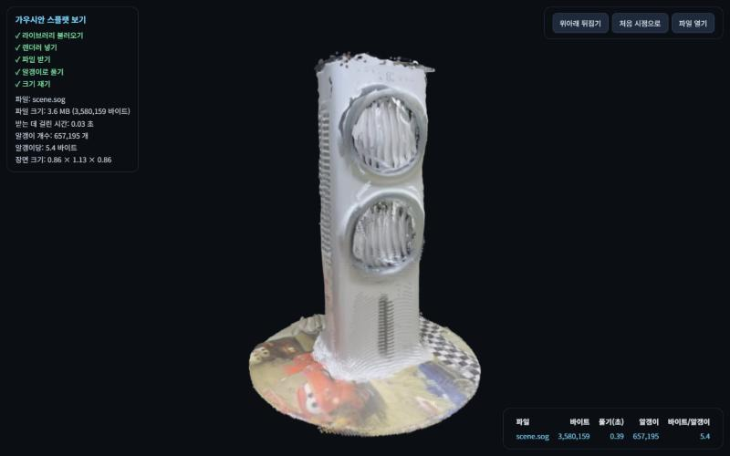

# 냉풍기 3D 뷰어

폰으로 한 바퀴 돌며 찍은 영상 하나에서 만든 가우시안 스플랫입니다.

- 보기: https://jsseo0420.github.io/my-open-space/
- 장면 파일: https://jsseo0420.github.io/my-open-space/scene.sog

## 1. 고른 대상과 공개해도 되는 이유

- **대상:** 거실 바닥에 세워 둔 타워형 냉풍기 한 대와 그 아래 바닥 일부(지름 약 0.86 단위의 원판)
- **공개 근거:** 시중에 파는 가전제품 하나만 남기고 주변을 모두 잘라내 공개해도 되는 범위로 줄였다.
  - 원본 영상에는 냉풍기 뒤로 거실 모습, 벽의 액자, 빨래 더미, 지나가는 가족의 다리(13~16번 프레임)가 찍혔다.
  - 그래서 복원한 점 중 냉풍기를 둘러싼 좁은 원기둥(카메라가 돈 원 반지름의 0.7배) 안쪽만 남기고 나머지는 지웠다.
  - 공개하는 장면에는 사람·얼굴·문패·주소·차량 번호처럼 사람이나 집을 알아볼 단서가 없다.
  - 원본 영상과 추출한 프레임, 자르기 전 점 파일은 저장소에 올리지 않았다.

## 2. 촬영

| 항목 | 값 |
|---|---|
| 촬영한 부분 | 냉풍기 앞면(송풍구 둘), 옆면, 뒷면(흡기 격자), 마지막에 윗면 |
| 걸은 경로 | 냉풍기를 가운데 두고 둘레를 한 바퀴 돈 뒤, 끝에서 폰을 들어 위에서 내려다봄 |
| 영상 길이 | 24.7초 |
| 해상도 | 1280×720, 29.96fps, 가로 |
| 추출한 프레임 | 24장 (같은 간격, 긴 변 1024px로 줄여 1024×576) |

## 3. 복원 결과

MapAnything(`facebook/map-anything-apache`)을 코랩 Tesla T4 GPU에서 fp16으로 돌렸다.

| 항목 | 값 |
|---|---|
| 복원 시간 | 14.3초 (24장) |
| 최대 GPU 메모리 | 6.74GB |
| 점 개수 | 3,299,600개 (축별 0.5/99.5% 밖을 빼고 원래 3,396,937개 중 97.1% 유지) |
| 장면 대각선 / 카메라 대각선 | 9.390 / 1.967 |
| **카메라 퍼짐 비** (카메라 대각선 ÷ 장면 대각선) | **0.209** (거실 전체 기준) |
| 냉풍기 주변만 남긴 뒤 | 657,195개 (19.9%), 장면 대각선 1.656, 퍼짐 비 1.09 |

- **퍼짐 비 0.209:** 0.1을 넘으므로 제자리에서 폰만 돌린 것이 아니라 걸으며 찍은 것이다.
- **자른 뒤 1.09:** 카메라가 남긴 물체 바깥을 둘러싸고 있으므로 1보다 크게 나온다.

**실제 촬영 경로와 비교**
- 복원된 카메라 24대를 위에서 보면 냉풍기를 중심으로 닫힌 원을 그린다. 원의 반지름은 냉풍기 중심에서 0.61 단위다.
- 원 위의 카메라는 모두 냉풍기를 향한다.
- 마지막 몇 대는 높이가 올라가며 아래를 내려다본다.
- 이것은 실제로 한 바퀴 돈 뒤 폰을 들어 윗면을 찍은 경로와 맞는다. 원본 20~23번 프레임에서 윗면이 보인다.

**장면을 똑바로 세운 방법**
- 카메라 시선들이 가장 가깝게 모이는 점을 냉풍기 중심으로 잡았다.
- 냉풍기 몸통 점들의 가장 긴 축을 위 방향으로 삼아 장면을 세웠다.
- 이렇게 잡은 위 방향은 카메라 기울기 평균과 13.0도 달랐다.

## 4. 형식별 비교

PLY를 만든 설정은 다음과 같다.
- 반지름 = K × 장면의 가장 긴 변 ÷ √N (K = 1.4, 가장 긴 변 1.127, 반지름 0.00195)
- 불투명도 0.9, 0차 색만 저장했고 f_rest는 넣지 않았다.

이 PLY를 `npx -y @playcanvas/splat-transform@3.10.3 -w`로 변환했다.

**공개한 장면 (냉풍기 주변, 657,195개)**

| 형식 | 파일 크기(바이트) | 원본 대비 | 변환 시간(초) | 브라우저에서 풀기(초) | 알갱이 개수 | 알갱이당 바이트 |
|---|---:|---:|---:|---:|---:|---:|
| scene.ply | 44,689,676 | 100.0% | - | - | 657,195 | 68.0 |
| scene.compressed.ply | 10,700,676 | 23.9% | 6.2 | 0.30 | 657,195 | 16.3 |
| **scene.sog** | **3,580,159** | **8.0%** | 7.3 | 0.42 | 657,195 | **5.4** |
| scene.spz | 4,031,262 | 9.0% | 8.8 | 0.55 | 657,195 | 6.1 |

**참고: 자르기 전 거실 전체 (3,299,600개)**

| 형식 | 파일 크기(바이트) | 원본 대비 | 변환 시간(초) | 알갱이 개수 | 알갱이당 바이트 |
|---|---:|---:|---:|---:|---:|
| scene.ply | 224,373,217 | 100.0% | - | 3,299,600 | 68.0 |
| scene.compressed.ply | 53,722,342 | 23.9% | 19.3 | 3,299,600 | 16.3 |
| scene.sog | 16,621,401 | 7.4% | 22.6 | 3,299,600 | 5.0 |
| scene.spz | 23,439,019 | 10.4% | 26.1 | 3,299,600 | 7.1 |

**확인한 것**
- **알갱이 개수:** 네 형식 모두 같다. 형식만 바꿨고 알갱이는 줄이지 않았다.
- **같은 시점에서 본 차이:**
  - 뷰어에 세 파일을 차례로 끌어다 놓고 같은 시점에서 뒷면 흡기 격자를 확대해 비교했다.
  - 격자 칸의 모서리는 세 형식 모두 똑같이 또렷했다.
  - 픽셀 평균 차이는 SOG 대비 compressed.ply 0.57/255, SPZ 0.95/255였다. 20/255 넘게 다른 픽셀은 없었다.
- **Pages에 올린 형식: `.sog`.**
  - 가장 작다. 알갱이당 5.4바이트로 원본 PLY의 8%다.
  - Spark 2.4.0 뷰어에서 바로 열린다.
  - 같은 시점에서 화면 차이가 눈에 띄지 않았다.
  - 원본 PLY(44.7MB)도 GitHub 100MiB 제한 안이지만, 폰에서 받을 양이 12배가 된다.

## 5. 첫 화면까지 걸린 시간

| 기기 | 통신 | 첫 화면까지 |
|---|---|---|
| 내 폰: 〔기종〕 | 〔와이파이 / LTE / 5G〕 | 〔초〕 |
| 다른 사람 폰: 〔기종〕 | 〔〕 | 〔초〕 |

## 6. 잘 보이는 방향과 안 나온 자리

**잘 보이는 방향**
- 앞면의 두 송풍구와 뒷면의 흡기 격자는 둥근 테두리와 격자 칸이 또렷하다.
- 둘레를 도는 동안 계속 화면 가운데 있었기 때문이다. 같은 면이 여러 프레임에 조금씩 다른 각도로 찍혀 시차가 충분했다.

**구멍·잡티가 드러나는 방향**
- **윗면 (위에서 내려다볼 때):**
  - 검은 얼룩과 흰 점이 뒤섞여 울퉁불퉁하다.
  - 원본 20~23번 프레임을 보면 윗면은 검고 반짝이는 조작판이다. 반사가 각도마다 달라 같은 지점을 짝지을 무늬가 없다.
  - 윗면은 마지막 몇 장에서만 비슷한 방향으로 찍혀 시차도 부족하다.
- **옆면 (옆에서 볼 때):**
  - 앞뒤보다 흐릿하고 표면이 물결친다.
  - 옆면은 무늬 없는 흰 플라스틱이라 정렬할 특징점이 적다.
  - 둘레를 도는 동안 비스듬히 스쳐 지나가는 프레임이 많았다.
- **바닥과 닿는 아랫부분:**
  - 흰 잡티가 번져 있다.
  - 냉풍기 그림자와 바닥 매트가 겹쳐 경계가 흐리다.
  - 모든 프레임에서 비스듬히 위에서 내려다봐서, 아래쪽 경계를 정면으로 본 장이 없다.
- **바깥 테두리:**
  - 바닥 원판의 가장자리는 일부러 자른 경계라 뚝 끊긴다.
